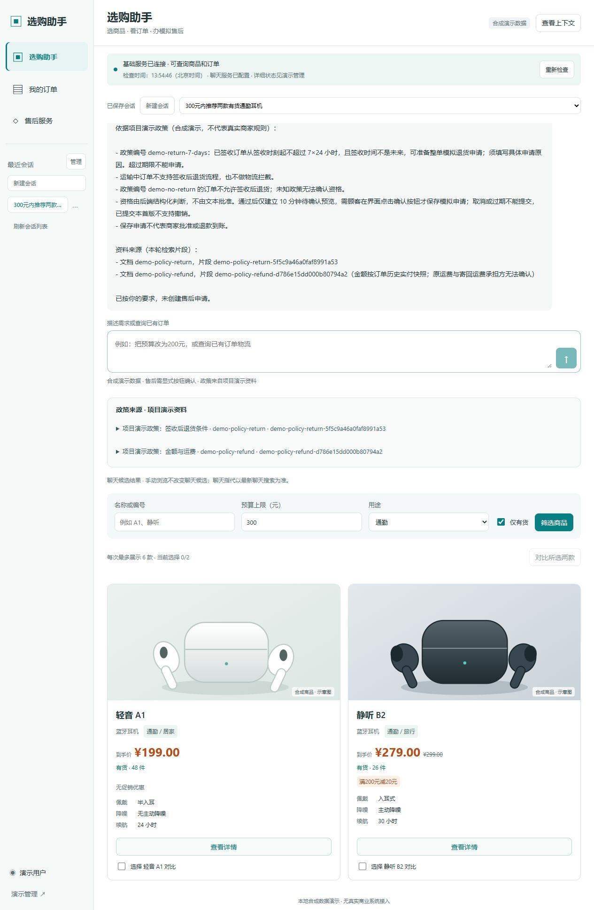
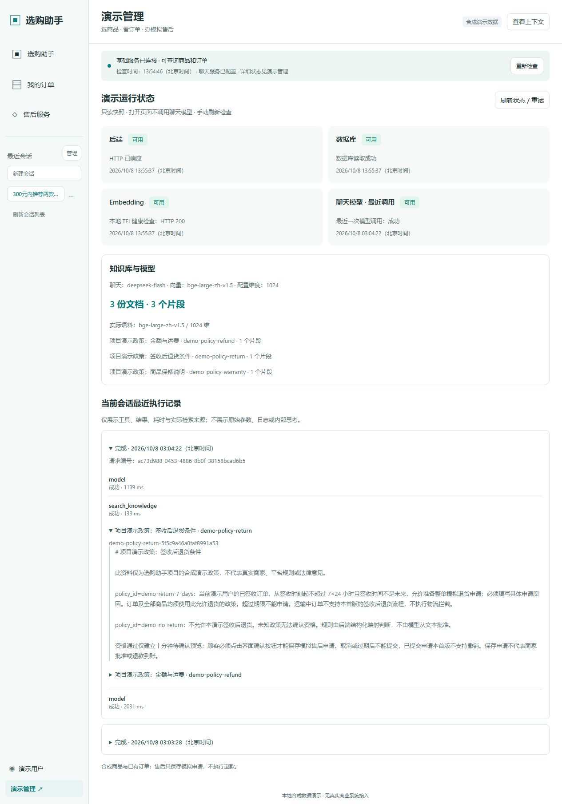

# 选购助手用户操作手册

本手册面向首次使用者。环境、安装、模型与 `.env` 配置见 [README：首次安装与配置](../README.md#首次安装与配置)，本地首次空库准备由现有启动入口完成，维护性刷新见[种子与知识入库](../README.md#启动种子与知识入库)，再按下列步骤操作。

## 使用前提

本项目使用 12 个合成商品、3 个已有演示订单和 3 份合成政策。推荐商品不会下单；售后只保存模拟申请，不表示商家批准、退款执行或到账。商品图片是示意图。

聊天配置缺失时，页面会提示“聊天模型未配置”，禁用聊天输入；后端和数据库正常时，手动筛选、详情、比较、订单查询及售后表单仍可用。整个应用是否可启动还取决于依赖、数据库等条件：一键启动会先启动本地 embedding，模型目录或镜像缺失会阻止这一启动路径，不能把它当作聊天配置缺失。

界面主导航与页标题统一为“选购助手”；其余三个入口为“我的订单”“售后服务”“演示管理 ↗”。窄屏使用顶部导航，最近会话可通过页面内的“选择最近会话”恢复；顶部“最近会话”的“管理”还可翻页访问旧记录。

## 一键启动与停止

| 操作 | 预期结果 |
|---|---|
| 首次双击根目录 `setup.cmd` | 缺依赖时按锁文件安装，缺 `.env` 时生成样例且不覆盖已有文件；检查配置、模型目录、Docker、已有镜像和端口，准备前端生产构建。缺项时显示具体提示，编辑 `.env` 可在根目录运行 `notepad .env`；补齐后再次双击。完整准备要求聊天三项配置，暂时只用手动功能可按 README 直接启动。 |
| 准备窗口显示“本地部署准备完成” | 按键关闭窗口，下一步双击 `start.cmd`。准备不会启动业务服务、初始化数据或打开浏览器；已有环境重复准备跳过安装与构建，不改已有商品、订单、知识或会话。模型接口可用性仍需启动后实际聊天验证。 |
| 双击根目录 `start.cmd` | 缺依赖时按锁文件安装；检查 Docker 引擎，必要时尝试启动 Docker Desktop；启动数据库和本地 embedding；空库时补齐本项目初始化，已有数据跳过；构建或复用前端生产产物，再启动或复用单进程本地部署。页面健康检查通过后打开默认浏览器。首次模型、镜像与配置仍需自行准备。 |
| 等待窗口显示“就绪” | 可访问 [选购助手页面](http://127.0.0.1:8000)。默认本地部署页面及 API 同在 8000；开发模式页面为 5173。 |
| 在已有部署服务正常运行且配置未变时再次双击 | 复用已登记且归属本项目的应用进程；同一应用运行会话只提交一次自动打开浏览器。并行启动锁会忽略重复点击。 |
| 手动关闭浏览器后再次双击 | 当前运行会话不会再次自动打开；手动访问 [页面链接](http://127.0.0.1:8000) 即可。手动提前打开的标签不在自动去重范围内。 |
| 关闭已完成启动的命令窗口或浏览器 | 不会停止后台前后端或 Docker 容器。启动过程中不要直接关闭窗口，可能留下已启动的部分服务。 |
| 双击根目录 `stop.cmd` | 等待本项目应用进程退出，停止本项目数据库和 embedding，核对端口后报告结果；保留数据卷、配置和模型。按键关闭结果窗口；已停止时再次执行可正常完成。未知占用会被报告，不会被强行结束。 |

本轮实际验证隔离首次锁文件安装、重复安装跳过、停止/新会话首次自动打开及连续启动锁。隔离安装仅代表现有机器，不代表全新机器；Docker 自动拉起未真实验证，因为其他项目容器正在运行，未关闭引擎。详细范围见[验收说明](ACCEPTANCE_AND_RELEASE.md#本地部署与启停专项验收2026-10-04)。开发入口、端口与模式切换见 [README](../README.md#开发运行与本地部署)。

日常停止直接双击 `stop.cmd`。需要命令行时，在**项目根目录**打开 PowerShell，运行：

```powershell
powershell -NoProfile -ExecutionPolicy Bypass -File .\scripts\dev.ps1 -Action Stop
```

预期结果：停止已登记的本项目应用进程以及数据库、embedding 容器，保留数据库卷。Docker Desktop 本身不会退出；脚本不会替你停止其他项目服务。停止成功后再双击 `start.cmd`，属于新的应用运行会话，可再次自动打开一次浏览器。

已有环境日常启动不会刷新商品/订单种子，也不会重新入库知识；首次空库才复用已有初始化实现。首次初始化与有意刷新演示数据的方法只在 [README](../README.md#启动种子与知识入库) 维护。

## 四页操作

### 选购助手页面

| 操作 | 预期结果 |
|---|---|
| 在“描述需求或查询已有订单”输入需求，点击发送箭头 | 出现等待状态；完成后显示模型解释和真实商品卡片。首版不逐字流式输出；等待期间不能重复发送。 |
| 输入“300元内推荐两款有货通勤耳机” | 按当前到手价、用途与库存查询；以当次卡片为准，模型措辞和候选数量不保证每次一致。 |
| 填写“名称或编号”“预算上限（元）”“用途”“仅有货”，点击“筛选商品” | 手动筛选结果每次最多 6 款；没有结果时提示修改条件。清空预算表示不限。 |
| 点击商品“查看详情” | 打开详情抽屉，显示真实参数、原价、优惠及到手价；缺参数显示“未知”。关闭抽屉返回列表。 |
| 勾选两款商品的对比选框，点击“对比所选两款” | 展示两款固定字段比较；不足两款不能比较。重新筛选会清除旧选择与比较。 |
| 聊天输入“第二款详情”或“对比这两款，关注降噪” | 使用最新聊天搜索候选进行指代。手动浏览不改变聊天候选；不足两款时需要先补足候选。 |
| 聊天输入“把预算改为200元” | 保留原用途等未修改条件，重新搜索并更新候选与比较状态。 |
| 点击“新建会话” | 清空当前视图；首条聊天消息或售后表单操作建立新的保存记录。已有会话不会被删除。 |
| 在侧栏“最近会话”或顶部“选择最近会话”选择记录 | 恢复已保存消息、条件及业务状态。刷新同一浏览器会尝试恢复上次选中的会话；失败时点击“重试恢复会话”。 |
| 请求失败后核对输入区的主要错误，点击“重试聊天” | 输入保留，刷新恢复最后失败轮也可重试；会话仅显示简短失败标记。相同失败输入重试更新该轮结果，不重复追加用户消息。失败时商品卡片可能是此前状态，不代表本次完成。 |

窄屏可点击“查看上下文”，查看筛选条件、商品对比和最近查询的订单，再用“关闭上下文”返回。

切回选购任务后，主区域展示商品与预算；历史售后申请保留在“售后服务”。依据保存的实际任务决定展示，聊天失败期间不把旧申请作为本次结果。已提交申请显示申请编号，不再突出已无操作意义的预览有效期与编号。



真实脱敏截图展示选购会话和 200 元商品结果；截图中的回答、时间与候选不是每次操作的固定结果。政策来源默认收起，点击标题可展开正文。各图日期与实际范围见[证据说明](evidence/README.md)。

### 会话管理

| 操作 | 预期结果 |
|---|---|
| 桌面右键点击最近会话项，或点击该项的“⋯” | 出现“删除会话”菜单；点击外部或按 Escape 关闭。手机通过“管理”内各项“⋯”操作，键盘可用 Tab 和 Enter。 |
| 选择“删除会话”，核对确认框中的会话名称，点击“确认删除” | 只删除选中的保存会话；取消不会删除。删除当前会话会回到新会话，清除消息、候选、详情、对比、来源、草稿及失败重试状态；删除其他会话不影响当前内容。 |
| 点击“最近会话”的“管理”，使用“上一页 / 下一页” | 查看全部历史的分页列表，每页最多20条，含标题及北京时间更新时间。点击标题恢复该会话并返回选购页；侧栏只保留最近20条。 |
| 勾选会话，或点击“全选当前页（最多20条）”，再点击“删除所选会话” | 显示已选数量；未选择时按钮禁用。确认框列出本次名称，多选删除成功后按实际数量提示。“全选当前页”不覆盖其他页，翻页重新选择。 |
| 点击“删除全部会话”，核对当前实际总数，再单独点击“确认删除全部会话” | 删除当前演示用户的所有保存会话，包括尚未加载的历史。此操作不可恢复；数量变化时必须刷新数量并重新确认。 |
| 遇到删除失败，等待忙碌操作结束后点击“重试删除” | 原列表、选择和当前会话保留，不把失败当作删除成功；不会重复提交正在执行的删除。 |
| 删除后刷新页面，或回到另一个同源标签页 | 已删除会话无法恢复；另一个标签页收到通知或检查到记录不存在时，回到可操作的新会话。 |

删除会话不可恢复，影响保存的显示消息、模型对话历史、候选、引用和响应缓存；不会删除商品、订单、政策向量或已保存售后申请。售后历史仍在“售后服务”查看，申请编号不变。会话删除后，原待确认预览不能通过已删除的会话继续确认；需要操作时从售后页按真实条件重新预览。只删除能由该会话请求缓存明确关联且未被其他会话引用的执行记录；无法可靠归属的旧记录仍保留，因此不是“清空所有日志”。

### 我的订单

| 操作 | 预期结果 |
|---|---|
| 点击“我的订单” | 加载当前演示用户已有订单，推荐不会产生新订单。 |
| 输入下表中的完整订单号，点击“查询订单”；或点击卡片“查看订单与物流” | 抽屉显示订单商品、历史实付、签收时间和物流节点。 |
| 遇到读取错误，点击“重试订单列表”或“重试订单详情” | 重新读取真实数据；不存在的订单不会返回假物流。 |

| 已有演示订单号 | 商品 | 历史实付 | 种子初始化后的状态 |
|---|---|---|---|
| `DEMO20261003001` | 轻音 A1 | 199 元 | 运输中，未签收 |
| `DEMO20261003002` | 静听 B2 | 279 元 | 已签收，签收时间为最近一次种子执行前 2 天 |
| `DEMO20261003003` | 远行 C3 | 479 元 | 已签收，签收时间为最近一次种子执行前 10 天 |

金额来自订单保存的历史实付，当前商品促销变化不会重算它。签收时间不会每天自动刷新，售后资格按页面真实时间和当前规则判断；长期不刷新种子时，002 也会超过七天期限。

### 售后服务

| 操作 | 预期结果 |
|---|---|
| 填写已有订单号和具体原因（例如“佩戴不合适”），点击“准备预览” | 合格时生成“待确认预览”，列出订单、原因、历史实付申请金额、十分钟有效期及确定性规则来源。只写“退货”“退款”“售后”不算具体原因。手动表单无需聊天模型。 |
| 核对预览，再点击“确认模拟申请” | 后端重新检查资格，保存模拟申请并显示申请编号；对同一预览重复确认返回同一申请。 |
| 不准备提交时点击“取消预览” | 该预览变为“已取消”，不能再确认；已提交申请不支持通过此按钮撤销。 |
| 修改订单或原因 | 页面仍可能显示旧预览，但不能直接确认更改后的内容；先点击“准备预览”生成对应的新预览。 |
| 超过十分钟 | 预览过期、未提交，需重新准备，不能把过期预览当申请成功。 |
| 刷新浏览器、恢复原会话，再进入“售后服务” | 重新读取已保存状态；已提交时应看到同一申请编号。点击“刷新记录 / 重试”可更新记录列表。 |

运输中、超出签收七天期限、商品政策不允许或未知等情况会明确拒绝。**聊天里说“确认”不能代替“确认模拟申请”按钮**。预览上的“确定性规则来源”与聊天检索得到的 RAG 来源不同。

### 演示管理

| 操作 | 预期结果 |
|---|---|
| 点击“演示管理 ↗” | 读取一次只读快照，不调用聊天模型，也不自动轮询。 |
| 查看服务卡片和检查时间 | “聊天模型 · 最近调用”表示历史调用结果；“未检查”表示没有可用检查证据，不等于失败。Embedding 可用仅说明本地健康检查成功。 |
| 查看“知识库与模型” | 显示实际入库文档、片段、模型和维度。文件存在不等于入库成功；数据库不可用时数量未知，不代表零条。 |
| 先在选购助手页面操作或恢复会话，再查看“当前会话最近执行记录” | 显示最近十次聊天请求的状态、工具、耗时和成功检索来源。展开来源可看标题、文档/片段编号与正文；来源不是模型凭空补充的。 |
| 点击“刷新状态 / 重试” | 重新读取快照。请求失败会清除旧结果；手动售后表单操作不会生成模型工具调用记录。 |



2026-10-04 本地生产构建运行的真实脱敏截图。执行记录默认收起，点击记录标题，再点击来源标题查看正文；当前验收范围以[验收与发布说明](ACCEPTANCE_AND_RELEASE.md)为准。

## 一条完整演示路径

先完成 README 的首次初始化；在同一会话按顺序操作。以下是可直接输入的示例，预期结果指业务事实与状态，不保证模型每次回答一致。若模型追问，补充实际缺项后继续。

| 步骤与操作 | 预期结果 |
|---|---|
| 1. 点击“新建会话”，输入：`300元内推荐两款有货通勤耳机` | 出现符合条件的真实候选。种子中轻音 A1 到手价 199 元、静听 B2 到手价 279 元；300 元通勤手动筛选还包含简声 F6，以当次聊天候选为准。 |
| 2. 输入：`第二款详情` | 详情属于上一轮聊天候选的第二款，不凭示例固定为某个商品。 |
| 3. 输入：`对比这两款，关注降噪` | 显示实际两款比较；未知参数不补造，主观建议不等于实测性能。 |
| 4. 输入：`把预算改为200元` | 保留通勤、有货条件；当前种子符合条件的只有轻音 A1。 |
| 5. 输入：`查询订单 DEMO20261003002 和物流` | 读取静听 B2 的已有订单，历史实付 279 元及真实签收/物流快照。也可到“我的订单”核对。 |
| 6. 输入：`项目演示政策中，签收后的退货条件是什么？请给出资料来源，暂不申请售后。` | 真实检索成功时展示本次政策来源（点击标题展开）；没有证据时明确无法确认，不把回答当批准。 |
| 7. 输入：`为订单 DEMO20261003002 准备签收后退货预览，原因是佩戴不合适，先不要提交。` | 当订单仍符合资格时显示待确认预览，金额 279 元；申请编号尚为空。 |
| 8. 到“售后服务”，核对订单/原因/金额后点击“确认模拟申请” | 显示“模拟申请已保存”与申请编号，记录该编号。聊天说“确认”不会完成此步骤。 |
| 9. 刷新浏览器，恢复同一会话，再进入“售后服务”并刷新记录 | 保持同一已提交申请编号，不重复建单。刷新后默认回到选购助手页面，需要再次切换页面。 |
| 10. 进入“演示管理 ↗”，点击“刷新状态 / 重试”，展开执行记录与来源 | 可核对本次推荐、比较、政策检索及售后预览的真实聊天执行过程。按钮确认本身不是模型调用记录。 |

若 002 已超期，此演示应停在明确拒绝状态，不能宣称预览/确认完成。需要重新演示时，由维护者按 [README 的种子步骤](../README.md#启动种子与知识入库)有意刷新本项目演示日期；不要清空数据库。刷新种子不会抹去已有售后记录。

## 常见问题

| 现象 | 最短处理步骤与预期结果 |
|---|---|
| 页面打不开 | 确认启动窗口显示“就绪”，手动访问 [页面](http://127.0.0.1:8000)。若启动失败，先看窗口错误；启动中断后可在根目录执行上面的 Stop，再双击启动。仍失败时查看本地 `.runtime/api-error.log`、`.runtime/web-error.log`，不要公开原始日志或密钥。 |
| 提示 8000/5173 端口被占用 | 核对占用者归属。若是本项目，先 Stop 后重启；其他服务应由其维护者处理。脚本不会停止其他项目，部署模式使用 8000，开发模式另用 5173；当前应用端口不能仅靠改 `.env` 调整。 |
| Docker 未就绪或等待超时 | 手动打开 Docker Desktop，确认 Linux 容器引擎运行后再双击；未安装则按 README 准备。不要仅凭此错误推断网络或 VPN 原因。 |
| 本地模型目录或镜像缺失 | 对照 [README：准备本地模型](../README.md#准备本地模型)核对目录、完整模型文件与镜像。启动脚本不下载模型，也不拉取镜像；准备完成后重试。 |
| 提示“聊天模型未配置” | 在本地 `.env` 补齐 README 的聊天三项配置，然后按下一行重载；手动商品、订单和售后表单仍可用。不要在聊天里粘贴密钥。 |
| 修改配置后没有生效 | 双击 `stop.cmd`，编辑根目录 `.env` 后双击 `setup.cmd` 检查准备，再双击 `start.cmd`，刷新页面并点“重新检查”。有意不配置聊天而只用手动功能时，可跳过 Setup 完整聊天检查直接启动。配置未变时重复双击复用进程；启动器检测配置变化会重建应用，页面“重新检查”本身不重载 `.env`。更换向量模型/维度还需按 README 重新探测与入库。 |
| 模型请求失败 | 保留输入，查看实际错误和演示管理的最近调用时间；核对接口、模型及原生工具支持，修正配置并重载后点击“重试聊天”。失败期间当前政策来源和购物主区的旧售后卡隐藏，保留的商品卡片标注为此前状态；历史聊天仍可查看。连接故障现在记录脱敏异常类型/错误码/HTTP状态/阶段，可由维护者查看本地日志；不根据一次失败猜原因，不要求切换 VPN，不公开原始日志。 |
| RAG 服务不可用 | 查看演示管理的 Embedding/数据库状态及语料模型/维度；按 README 检查健康、探测与入库步骤，修正后显式重试原问题。 |
| RAG 无证据或无相关资料 | 尝试具体询问项目演示的签收退货、金额/运费边界或保修政策；仍无来源则保留“无法确认”。三份政策不覆盖所有问题，无匹配不等于服务故障。 |
| 搜索无结果 | 清空名称关键词、提高预算或调整用途/库存条件，再点“筛选商品”；无货或超预算不会被编成符合条件的商品。 |
| 订单不存在 | 从“我的订单”复制实际已有订单号，核对演示用户及首次种子是否已初始化；不存在的订单不能继续申请。 |
| 售后不符合条件或预览过期 | 查看页面拒绝原因、真实签收时间及政策；填写具体原因。过期需重新预览，运输中/超期等不符合条件的订单不能确认。 |
| 浏览器关闭后没有自动打开 | 手动访问 [页面](http://127.0.0.1:8000)。后台仍运行时不用重启；当前运行会话不会再次自动打开。 |
| 会话或申请刷新后没显示 | 使用同一浏览器从最近会话或“管理”恢复未删除的记录，再到“售后服务”刷新记录；已删除会话不能恢复，但已保存售后申请仍可查看；读取失败时显式重试。新浏览器没有原浏览器本地选择记录，可从会话列表选择，不要用新申请代替状态恢复。 |

## 可选开发者入口

API 文档入口、必要检查与评测、MCP 启动配置集中在 README：[API 文档与初始化](../README.md#启动种子与知识入库)、[评测与检查](../README.md#演示与检查)、[MCP](../README.md#mcp)。普通页面操作无需使用这些入口。
