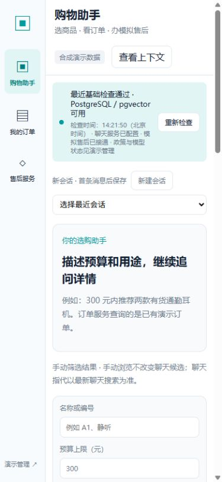
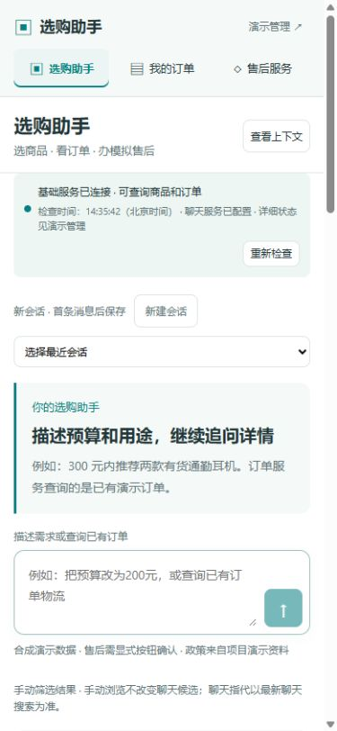

# 有限实际演示证据

当前源码仓库为 [Yrong-z/Agent-E-commerce](https://github.com/Yrong-z/Agent-E-commerce)。下文“发布暂停”是各次验证发生时的历史状态，不代替最新源码交付安排；用户人工验收仍为 pending，公开截图和自动走查不等于人工或生产验收。

公开截图按各条标注日期保留：选购图和管理图更新于 2026-10-08，窄屏对比为 2026-10-04；此前 O5 原截图与原始记录保留在本地。操作见[用户手册](../USER_GUIDE.md)，验证范围与失败历史见[验收与发布](../ACCEPTANCE_AND_RELEASE.md)。截图包含合成商品、演示订单/申请与脱敏执行摘要，不含个人路径、密钥或原始日志。

- [选购助手实际页面](ui-shopping.jpg)：2026-10-08 生产版真实 300 元推荐后的政策问答与当前来源；侧栏含会话管理入口，候选是本轮真实 A1/B2，未创建售后申请。
- [演示管理](ui-admin.jpg)：2026-10-08 真实服务检查时间、三文档/三片段/1024 维、当前会话执行与实际 RAG 来源；聊天状态标有最近调用时间，不冒充当前实时请求，embedding 表示本地健康检查。
- [二十案例脱敏摘要](evaluation-summary.json)：保留 2026-10-03/04 O7 的首次 19 通过/1 失败/0 未运行与最终 20/0/0；本次 UI 优化没有重跑或改写评测数量。
- [MCP 协议摘要](mcp-summary.json)：2026-10-03 官方 SDK stdio 两个只读工具九组检查；本次没有重跑协议验收。

截图与 Codex 浏览器走查不能代替用户人工验收（pending）。商品 SVG 为中性示意图；售后保存只代表模拟申请，不表示商家批准或退款。有限样本不证明生产性能/真实交易；新机器首次安装与 Docker 自动拉起未验收。原始报告、失败历史、大部分阶段截图与安装记录只在本地保留；下表仅公开两张真实布局对比图。

## 实际窄屏布局对比

两图均为 2026-10-04、390×844 视口、新会话初始页面的真实截图，保留当时界面文字。优化前旧标题是历史记录；当前页面名称为“选购助手”。此表用于修正上一轮未呈现图片的对比表，不作为本轮失败与恢复的证据。

| 优化前：侧栏占用窄屏宽度 | 优化后：顶部导航与正常文档流输入 |
|---|---|
|  |  |

本轮独立验收实际完成十项操作清单及聊天超时、RAG 依赖失败与显式重试两项检查。发现的旧来源误显示已修复；失败期间隐藏当前来源，恢复后显示本次真实检索来源。用户人工验收仍为 pending；未验证的安装/启动分支与轻微视觉问题见[验收说明](../ACCEPTANCE_AND_RELEASE.md)。

## 本地部署截图更新

2026-10-04 两张页面图曾更新为 FastAPI 托管的真实生产构建（8000），界面和同源 API 已在浏览器实际操作。当时选购图包含政策来源及模拟申请，管理图包含当时检索记录，现均由 2026-10-08 图片替换。优化前后表保留相同初始场景的历史布局图，旧图备份本地保留。用户人工验收仍 pending，未宣称公网部署或新机器安装通过。

2026-10-08 针对人工反馈曾仅更新选购图；本次发布准备验收再更新选购与管理两图，补入当前会话管理入口、两次必要真实聊天及检索证据。此前 200 元结果图、旧管理图和原始验收截图继续本地保留，历史窄屏对比不改写。历史聊天连接根因因旧异常链缺失尚未定位；当前真实调用恢复不等于永久网络修复，最终发布暂停，人工验收仍 pending。
